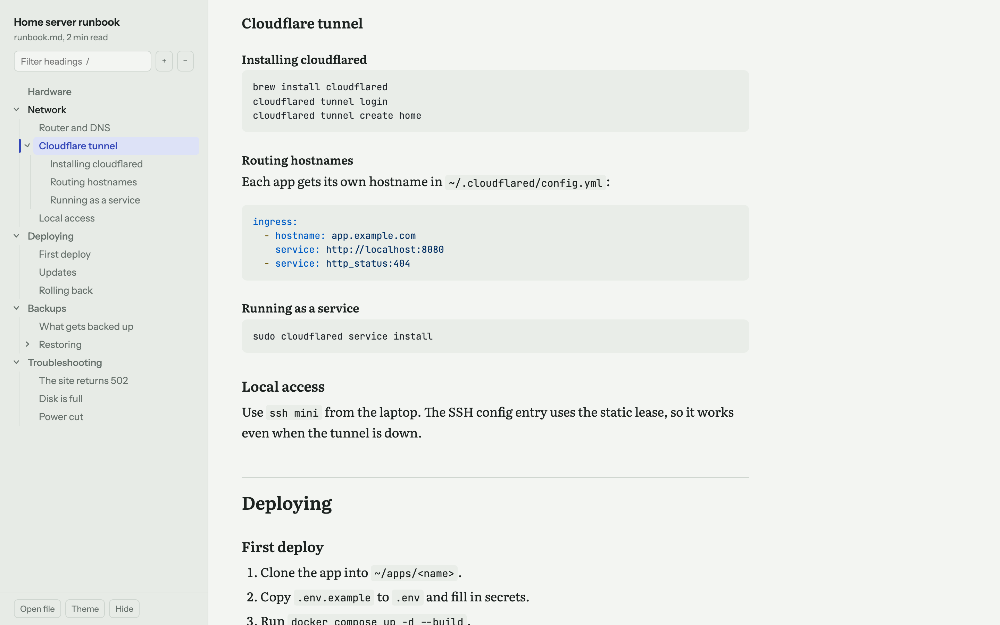
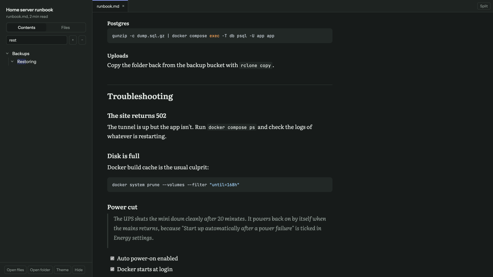
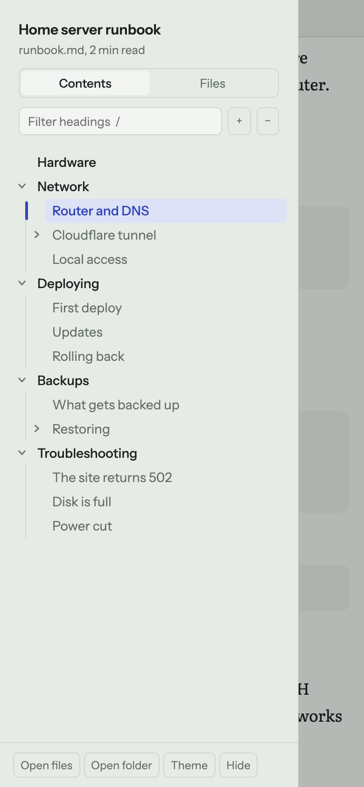

# mdview

A static HTML viewer for Markdown files with a sidebar built from all headers and subheaders.



## What it does

- Sidebar tree of every heading (H1–H4), with nesting lines and fold/unfold per section
- The section you're reading is highlighted as you scroll, and its branch opens automatically
- Filter headings by typing (press `/` to jump to the filter)
- Light and dark themes, following the system by default
- Syntax highlighting, GFM tables and task lists
- Works on phones: the sidebar becomes a drawer

| Dark theme, filtering headings | Phone |
|---|---|
|  |  |

## Usage

### Bake a Markdown file into a standalone page

```bash
./mdview notes.md            # writes notes.html next to it
./mdview docs/               # converts every .md under docs/
./mdview notes.md -o out.html --open
```

The output is a single `.html` file that opens straight from disk. Links between converted `.md` files are rewritten to the `.html` pages, and relative images keep working because the page sits next to the source.

To have it on your PATH:

```bash
ln -s "$PWD/mdview" /usr/local/bin/mdview
```

### Open files in the viewer directly

Open `viewer.html` in a browser and drop a `.md` file on it, or use **Open file**.

When the folder is served over HTTP, `viewer.html?src=path/to/file.md` loads that file:

```bash
python3 -m http.server
# http://localhost:8000/viewer.html?src=examples/runbook.md
```

## Keyboard

| Key | Action |
|-----|--------|
| `/` | Filter headings |
| `Esc` | Leave the filter |
| `[` | Show or hide the sidebar |

## Notes

- Requires Python 3 for the `mdview` command; no packages needed.
- Rendering uses [marked](https://marked.js.org) and [highlight.js](https://highlightjs.org) from a CDN, so pages need a network connection the first time.
- Rendered HTML goes through [DOMPurify](https://github.com/cure53/DOMPurify), so scripts inside a Markdown file don't run.
- `?src=` only loads files from the same site as the viewer.
